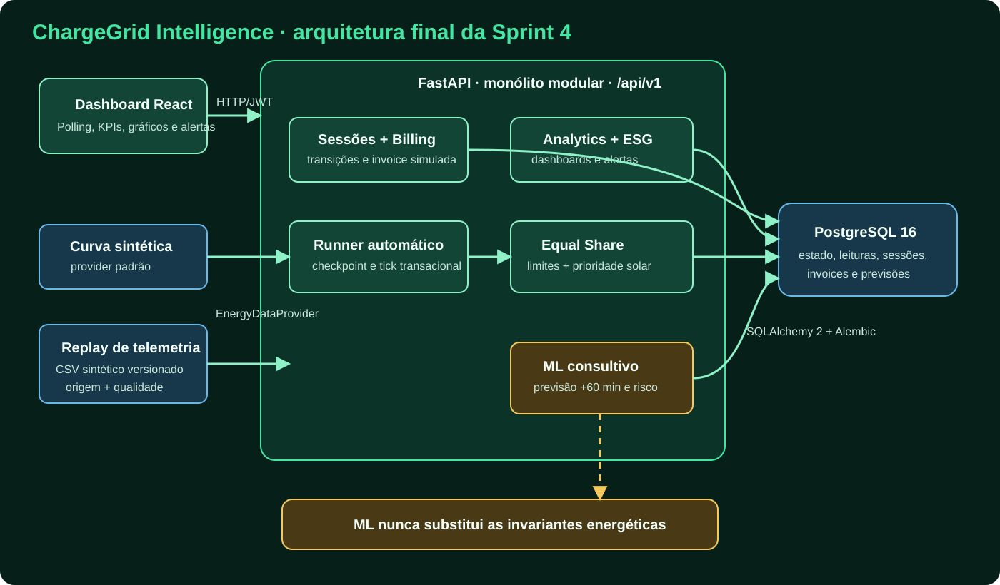
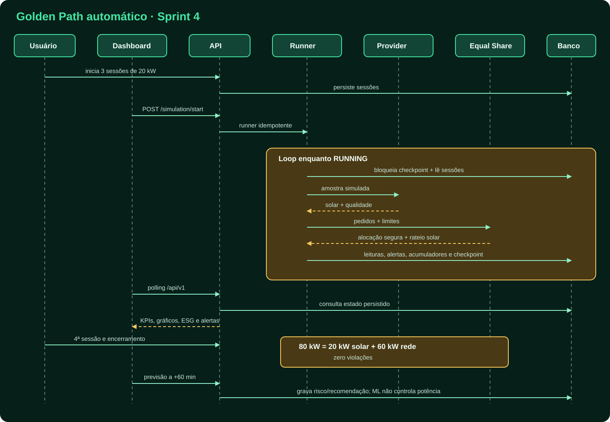
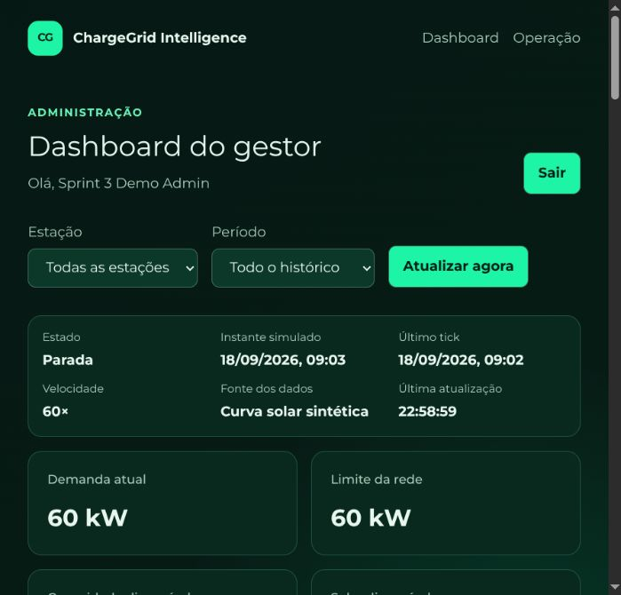
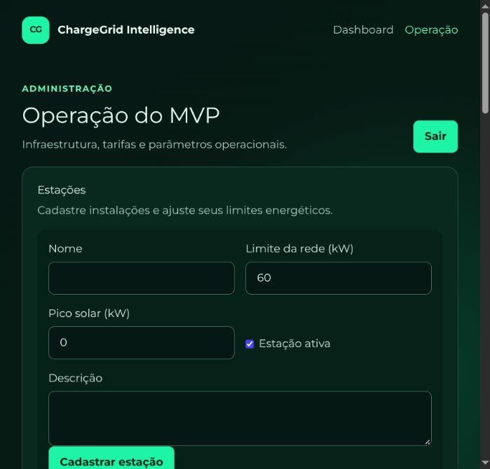

# ChargeGrid Intelligence — entrega Sprint 4

> Demonstração acadêmica com dados, equipamentos, billing e telemetria
> **simulados**. Não existe conexão física com inversores, gateways ou estações
> de recarga GoodWe.

**Equipe:** Equipe 3 — FIAP × GoodWe

**Disciplina:** Pensamento Computacional e Automação com Python

**Integrantes:** Bernardo Zauza Amorim, Bruno Almeida de Oliveira, Gabriel Góes
Nunes Pereira, Guilherme Vinciguerra Carvalho, Marcos Peterson Martins Pereira
e Matheus Jorge Santana.

## Estado da execução

| Etapa | Estado | Material |
| --- | --- | --- |
| 1 — Baseline e rastreabilidade | Concluída em 20/10/2026 | [`EVIDENCE.md`](EVIDENCE.md) e [`traceability-matrix.md`](traceability-matrix.md) |
| 2 — Dashboard vivo | Concluída em 20/10/2026 | `frontend/src/pages/AdminDashboardPage.tsx` |
| 3 — Telemetria reproduzida | Concluída em 20/10/2026 | [`telemetry-contract.md`](telemetry-contract.md) e `data/raw/sprint4_telemetry.csv` |
| 4 — Golden Path automático | Concluída em 20/10/2026 | `scripts/sprint4_demo.py` |
| 5 — Documentação e diagramas | Concluída em 20/10/2026 | este guia, diagramas, resultados, roteiro e capturas |
| 6 — Validação final | Pendente | execução final de `make check`, `make mvp-smoke` e ensaio manual |

O plano completo está em
[`plano_desenvolvimento_sprint4.md`](plano_desenvolvimento_sprint4.md).

## Problema e solução

Infraestruturas de recarga precisam atender vários veículos sem ultrapassar a
rede contratada, aproveitar geração solar e oferecer informação operacional.
O ChargeGrid resolve esse recorte com um monólito modular que:

- cria e encerra sessões de recarga;
- avança um relógio acelerado por um runner automático;
- aplica Equal Share com limites físicos e prioridade solar;
- persiste leituras, billing simulado, alertas e indicadores ESG;
- apresenta um dashboard que acompanha a simulação;
- prevê demanda a 60 minutos, compara o modelo com um baseline e produz uma
  recomendação estritamente consultiva.

## Arquitetura final



[Fonte Mermaid](architecture.mmd). O frontend React consome a API FastAPI sob
`/api/v1`. O backend executa como monólito modular, usa SQLAlchemy e PostgreSQL
e seleciona por configuração entre curva solar e replay de telemetria. A fonte
fornece apenas disponibilidade solar; `EqualSharePowerResolver` continua sendo
o único responsável pela alocação e por suas invariantes.

## Fluxo integrado



[Fonte Mermaid](sequence.mmd). O endpoint de início cria um único runner por
processo. Cada tick bloqueia o checkpoint persistido, amostra a fonte
energética, aloca potência, grava leituras e avança o relógio na mesma
transação. O dashboard faz polling apenas enquanto o estado é `RUNNING`, evita
consultas sobrepostas e mantém uma atualização manual disponível.

## Automação e telemetria simulada

O relógio usa, por padrão, um segundo real para um minuto simulado. Start e
stop são idempotentes, ticks concorrentes são serializados no PostgreSQL e uma
falha isolada não encerra o runner.

`ENERGY_DATA_PROVIDER` aceita:

- `curve` — padrão, curva solar UTC determinística;
- `telemetry_replay` — procura uma amostra exata por estação e instante em um
  CSV versionado.

O replay valida timestamps com fuso, valores finitos e potências não negativas,
limita o fotovoltaico ao pico da estação e retorna zero com qualidade `MISSING`
quando não existe amostra. O contrato detalhado está em
[`telemetry-contract.md`](telemetry-contract.md).

## Aderência conceitual ao ecossistema GoodWe

Inversores e gateways reais normalmente disponibilizam telemetria energética.
O provider de replay representa a fronteira na qual uma futura adaptação
permitida pelo equipamento entregaria essas medições ao motor. A prova desta
Sprint é de **substituibilidade arquitetural**: trocar a curva por replay não
altera sessão, banco, API, dashboard ou regras de alocação.

Isso não comprova nem alega comunicação real GoodWe, Modbus ou OCPP. Uma
integração física futura exigiria confirmar protocolo, autenticação, unidade,
frequência, qualidade e tratamento de indisponibilidade do equipamento alvo.

## Gestão energética e segurança

Antes de persistir um tick, o backend garante:

```text
0 <= potência alocada
potência alocada <= pedido, carregador e veículo
potência total da rede <= limite da estação
solar utilizado <= solar disponível
```

O solar complementa a capacidade da rede e tem prioridade na composição da
energia. O ML jamais sobrescreve essas regras.

## Machine Learning e baseline

O pipeline usa features causais, horizonte de 60 minutos, divisão temporal e
janela expansiva. A seleção compara modelos simples com a média histórica por
hora e dia da semana. Na execução documentada, o
`HistGradientBoostingRegressor` venceu por RMSE. MAE, RMSE e R² estão em
[`results.md`](results.md) e na documentação de avaliação geral em
[`../ML_EVALUATION.md`](../ML_EVALUATION.md).

## Resultados e sustentabilidade

No marco principal, quatro sessões solicitaram 80 kW. O sistema entregou 20 kW
solares mais 60 kW da rede, sem violar o limite. O ensaio acumulou 12,3667 kWh,
19,1375% de participação solar, 0,9467 kg de CO₂ evitado e R$ 1,89 de economia
solar teórica. Uma sessão encerrou com 1,175 kWh e invoice de R$ 0,94.

O CO₂ evitado é calculado como energia solar multiplicada pelo fator de emissão
configurado da rede. A economia representa o valor teórico da energia solar que
teria sido comprada pela tarifa; não é promessa de economia financeira real.
Veja a [tabela integral e seu escopo](results.md).

## Diferenciais demonstrados

- simulação viva e reproduzível sem depender da duração real de uma recarga;
- fonte de dados substituível com qualidade explícita;
- alocação determinística separada de telemetria e ML;
- rastreabilidade de requisitos, testes e evidências;
- integração de energia, previsão, alertas, billing e ESG no mesmo Golden Path.

## Tecnologias

Python 3.12, FastAPI, Pydantic v2, SQLAlchemy 2, Alembic, PostgreSQL 16,
Pytest, React, TypeScript, Vite, Recharts, Vitest, Pandas, NumPy,
Scikit-learn, Joblib, Docker e Docker Compose.

## Como reproduzir

Pré-requisitos: Docker Engine com Docker Compose e portas 18000/15173 livres.
Na raiz do repositório:

```bash
make mvp-smoke
```

Esse é o caminho mais seguro: cria um projeto isolado, aplica migrations,
carrega seed, prepara ML, sobe os serviços, executa o Golden Path apenas pela
API pública e remove containers e volumes ao final. A saída JSON contém os
resultados quantitativos.

Para uma apresentação com a interface aberta, copie `.env.example` para um
`.env` local, selecione `ENERGY_DATA_PROVIDER=telemetry_replay`, indique
`TELEMETRY_REPLAY_PATH`, defina as senhas da demo somente no ambiente e siga a
mesma sequência usada por [`scripts/mvp_smoke.sh`](../../scripts/mvp_smoke.sh),
omitindo o cleanup até terminar a apresentação. Nunca versione o `.env`.

Contas do seed:

- gestor: `sprint3-admin@demo.invalid`;
- usuários: `sprint3-user-1@demo.invalid` a
  `sprint3-user-4@demo.invalid`.

As senhas são os valores definidos em `DEMO_ADMIN_PASSWORD` e
`DEMO_USER_PASSWORD`; não existem senhas fixas no repositório.

## Como validar

```bash
make check
make mvp-smoke
```

`make check` executa lint, tipos, testes backend/frontend e build. O smoke
valida migrations e o fluxo integrado em PostgreSQL limpo. A etapa 6 ainda
deverá repetir ambos e ensaiar visualmente login, start/stop, quarta sessão,
solar, previsão, alertas, invoice e ESG.

## Evidências visuais

As capturas abaixo foram feitas em 20/10/2026 sobre o build de produção, após o
Golden Path automático. Elas mostram dados simulados.





O dashboard exibe atualmente “Curva solar sintética” como rótulo fixo mesmo
quando a demo usa replay. A fonte efetiva do ensaio é comprovada pela
configuração do backend e pelo resumo JSON, e essa discrepância visual é uma
limitação conhecida, não evidência de troca de provider.

## Limitações e trabalhos futuros

- não há hardware, protocolo Modbus/OCPP, pagamento real ou bateria;
- telemetria, billing, emissões, economia e demanda são simulações acadêmicas;
- o processo automático pressupõe um runner por instância; o lock do banco
  evita duplicidade de ticks, mas não substitui coordenação operacional de um
  deployment distribuído;
- o dashboard ainda rotula a fonte como curva solar de forma fixa;
- no servidor Vite de desenvolvimento, o `React.StrictMode` pode deixar a tela
  administrativa em “Carregando” após a remontagem; o build de produção usado
  nas capturas carrega normalmente;
- o replay usa correspondência exata e fallback zero; interpolação e retenção
  da última amostra ficariam para um contrato futuro explícito;
- o modelo depende do artefato treinado e de histórico causal compatível;
- uma integração GoodWe real dependeria de documentação e acesso autorizados
  ao equipamento específico.

## Materiais da entrega

- [evidências de execução](EVIDENCE.md);
- [matriz de rastreabilidade](traceability-matrix.md);
- [resultados quantitativos](results.md);
- [contrato de telemetria](telemetry-contract.md);
- [roteiro do vídeo](video-script.md);
- [arquitetura Mermaid](architecture.mmd) e
  [sequência Mermaid](sequence.mmd).

